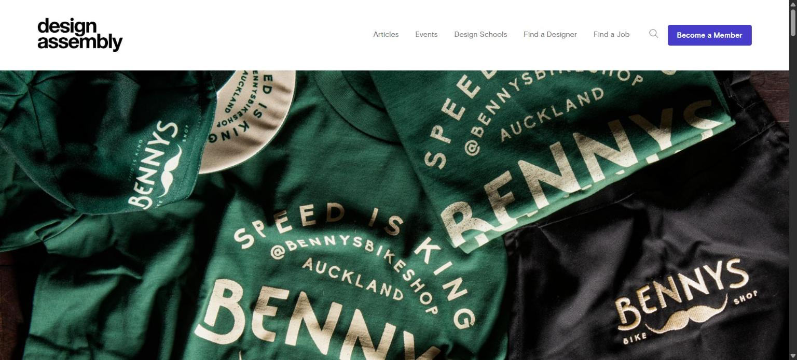
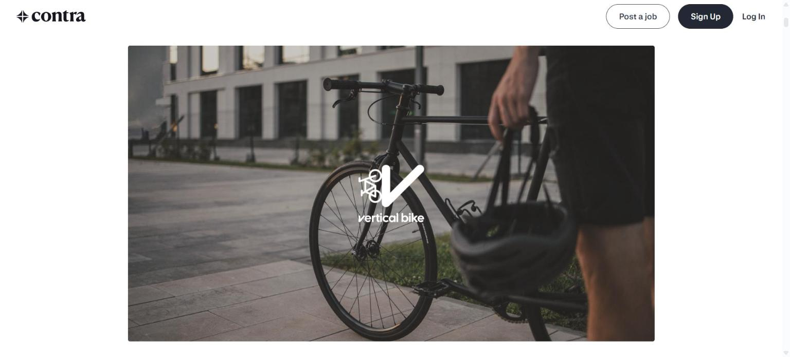
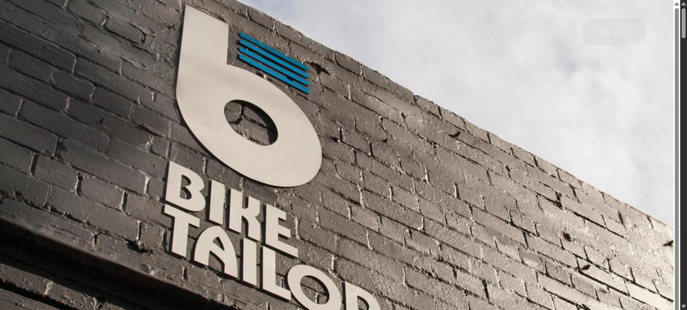

# Referências visuais

Identidades de oficinas de bicicleta encontradas na pesquisa (`02-pesquisa.md`). Os prints são das páginas dos projetos e servem só para estudo.

## Benny's Bike Shop (Onfire Design, Auckland)

Fonte: [Design Assembly](https://designassembly.org.nz/2023/11/22/fresh-from-the-field-bennys-bike-shop-by-onfire-design/)

**O que vi:** roupas e acessórios verdes com letras cor de creme, um texto em arco ("Speed is king") e um logotipo com bigode.

**O que aproveitei:** poucas cores. Só com verde e creme a marca já é reconhecível. Na Biela usei apenas grafite, giz e amarelo.

## Vertical Bike (Etiério Santos, São Paulo)

Fonte: [Contra](https://contra.com/p/L2vQmXqq-vertical-bike)

**O que vi:** logotipo branco e simples sobre uma foto de bicicleta urbana. O nome vem das bikes penduradas na parede da loja.

**O que aproveitei:** é uma oficina de São Paulo, como a Biela, e a marca é só símbolo e nome. No topo da Biela coloquei só o nome, sem enfeites.

## Bike Tailor (Created by South, Melbourne)

Fonte: [Created by South](https://createdbysouth.com.au/bike-tailor)

**O que vi:** fachada de tijolo cinza com um "b" grande cor de creme, listras azuis e o nome em letras de letreiro. A página diz que a marca usa imagens vintage e o estilo Bauhaus.

**O que aproveitei:** o letreiro da loja é a identidade da marca. Por isso usei uma fonte de letreiro nos títulos.

## Sem print

BIKE 101 Shop & Repairs (Alexandra Chulkova). A busca não trouxe um link claro, então não vi o projeto. Foi descrito com fonte Roboto Condensed e o vermelho como única cor de destaque.

## Fonte tipográfica

Big Shoulders Display, no [Google Fonts](https://fonts.google.com/specimen/Big+Shoulders+Display).
